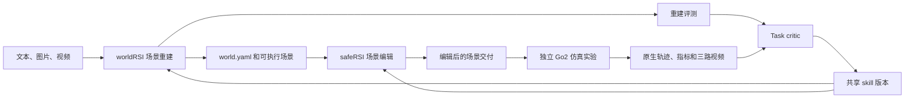

# worldRSIv3

worldRSIv3 是一个面向机器人的 **场景重建、场景编辑和闭环仿真实验工作台**。它从文本、图片和视频重建可执行的物理场景，再以该场景为基础构造安全测试。场景的语义、物理参数和证据以 `world.yaml` 表达，几何、碰撞、动力学及自定义求解器由 Newton 和 Python Warp 代码实现。交付文件可在仿真中重新执行，也可用于下一轮场景编辑。

项目把场景生成和机器人实验分成两个阶段。worldRSI 与 safeRSI 共同积累可复用的场景建模、物理求解和验证经验。运行记录供 critic 审阅，能推广的做法才进入 RSI 的技能候选。



## 工作流

1. **重建**。在 `/` 上传图片或视频，写下需要还原的对象、运动和相机要求。agent 编写原生 Newton `Example(viewer, args)`，可调用 Warp kernel 实现所需的物理机制。提交后保留 world、代码和实际依赖闭包。工作台支持查看原生状态、正式渲染和自由浏览。重建完成后按输入和场景类型运行适用的 4DCodeBench 评测。
2. **编辑**。在 `/safe` 从缩略图选择一个重建存档，说明要修改的场景条件，例如缩窄通道、改变表面摩擦或调整能见度。任务冻结源场景，用同一随机种子、同一时刻和机位比较修改前后。run critic 检查指令、原生状态和图像证据，任务交付编辑后的场景。
3. **执行机器人实验**。场景交付后，独立评测 agent 根据原始指令确定 Go2 的起点、目标点、相机和运行时长。评测在加载时装配机体，并沿用场景的物理解算流程。xNavDP 每 2 秒仿真时间推理一次，MoE-CTS 以 50 Hz 输出步态控制。Go2 装配已验证使用 `SolverXPBD` 和 `SolverSemiImplicit` 的场景，实际可执行性由独立物理预检确认。
4. **生成策略视觉**。Warp 从当前物理状态导出相机深度与法线。首次参考图通过 gpt-image-2 将第一人称 proxy 作为几何约束，将原始素材的一帧作为外观参考。每个动作区间执行结束后，AgentGarten 接收截至该时刻的几何条件，返回的视频末帧进入下一次导航。渲染默认以 10 FPS 采样，按 16 秒窗口保留上下文，跨窗口以实际尾帧作参考。
5. **审阅与进化**。在 `/rollouts` 同步查看神经首视角、Warp 首视角和 Warp 第三人称，以及轨迹、终点距离、跌倒状态和评测过程。run critic 的经验用于同一任务后续 run。task critic 结合场景与实验结果提议可复用的 skill，候选记录独立版本和来源。工作台也支持按固定样本与技能版本比较多轮实验结果。

场景时间由物理引擎推进，模型推理与神经渲染的等待时间单独记录。神经 RGB 提供策略的视觉观测，实际接触、运动和评测状态来自仿真。当前机器人部分使用预训练 Go2 策略做仿真实验。

## 运行组件

| 路径 | 职责 |
| --- | --- |
| `harness/core/`、`harness/agents/`、`harness/prompts/` | agent session、角色工具、上下文和固定提示 |
| `harness/tools/newton/`、`harness/sandbox/` | Newton/Warp 场景执行、原生观测、交付闭包、只读资源挂载与 Docker 隔离 |
| `harness/tools/go2/` | Go2 装配、xNavDP 和 MoE-CTS、神经视频接口及 rollout 录像 |
| `orchestration/` | 场景任务、独立实验、资源调度、证据归档和 skill 版本 |
| `evaluation/` | 4DCodeBench 适配、媒体参考、VQA 与版本指标 |
| `web/` | 控制器 API、重建与编辑工作台、自由浏览和 rollout 历史 |
| `scripts/` | 下载并准备独立仿真、评分、样本及 Go2 资源 |

场景 agent 的运行合同从 `docs/` 挂载到容器。定义与索引见 [world state](docs/world-state.md)、[原生场景接口](docs/newton-runtime.md) 和 [Newton API 索引](docs/newton-api.json)。

## 安装与启动

在 Linux x86-64 上准备 Python 3.12、Git、Docker 和带 H.264、VP9 编码器的 FFmpeg，确认当前用户可以运行 Docker。CUDA 仿真、SAM3、完整评分和 Go2 实验需要适配的 NVIDIA GPU、驱动和容器支持。Newton/Warp 与 Torch 的 CUDA 版本分别由其环境决定。 [NVIDIA Container Toolkit](https://docs.nvidia.com/datacenter/cloud-native/container-toolkit/latest/install-guide.html)

```bash
git clone https://github.com/xdt11/worldRSIv3.git
cd worldRSIv3
python3.12 -m venv .venv
.venv/bin/python -m pip install -r requirements-controller.lock
./run.sh build
./run.sh check
```

`./run.sh build` 生成 `worldrsi:newton`，提供场景沙盒所需的系统库。Python、Newton、感知模型和其他大文件由宿主准备，任务启动时再挂载。 `./run.sh check` 检查 Docker 和场景镜像。

```bash
./run.sh serve
```

浏览器打开 `http://127.0.0.1:8789`。 `WORLD_RSI_HOST` 与 `WORLD_RSI_PORT` 可调整监听地址和端口。服务启动后可以先浏览界面，在提交任务前按下文准备相应资源。

### 模型服务与运行配置

模型服务需提供兼容 Responses 的 `/v1/responses` 接口，支持工具调用和图像输入。设置页可以填写 `base_url`、可用模型 `models`、生成模型 `model` 和审阅模型 `critic_model`。凭据由控制器从环境变量 `WORLD_RSI_API_KEY` 或本地 `.env` 读取，后者使用 `WORLD_RSI_API_KEY=…` 格式。Go2 实验还要求同一模型服务提供 gpt-image-2 的 `/images/edits`。

控制器读取本地 `data/config.json`，可以用设置页保存。常用配置如下。

| 配置 | 用途 |
| --- | --- |
| `max_runs`、`max_calls_per_run` | 控制每个任务的迭代次数和每轮模型调用预算 |
| `sandbox.gpus`、`sandbox.cpus`、`sandbox.memory` | 场景沙盒的硬件限制，GPU 默认自动分配 |
| `evaluation.image`、`evaluation.gpus` | 重建评分镜像与 GPU |
| `rollout.enabled` | 场景交付后自动调度独立实验，仅编辑时设为 `false` |
| `rollout.duration_s`、`rollout.max_duration_s` | 实验默认和允许的最长仿真时间 |
| `rollout.renderer_url` | 同主机 AgentGarten 包装服务的 loopback 地址，默认 `http://127.0.0.1:8786` |
| `outer_rsi` | 控制任务级经验提炼和候选提案 |

## 资源下载与准备

资源按功能准备。路径以仓库根目录为基准，资源和执行产物均保存在本地 `data/`。

| 功能 | 必需资源 |
| --- | --- |
| 场景任务和自由浏览 | Linux Python 3.12 独立前缀、Newton 1.6.1、Warp 1.17.0、场景镜像 |
| 图像感知 | DA3-SMALL、SAM3 的源码、权重与兼容的感知 Python 包 |
| 重建评测 | 固定版本 4DCodeBench、评分镜像和 CUDA 包、相应 checkpoint 与样本参考数据 |
| Go2 闭环实验 | Go2 URDF 和 meshes、MoE-CTS、xNavDP、AgentGarten 服务和模型、gpt-image-2 接口 |

### Newton 与 Warp

选择与 Linux x86-64 和 Debian Bookworm 容器 ABI 相容的 Python 3.12 独立发行包，解包到 `data/resources/perception/python/`。该目录应直接包含 `bin/python` 和 `bin/python3.12`，以及标准库和开发头文件。 [Python standalone 发行包](https://github.com/astral-sh/python-build-standalone/releases)

```bash
.venv/bin/python scripts/prepare_newton_resources.py --install \
  --python-source data/resources/perception/python
```

脚本从独立前缀建立 `data/resources/newton_env/`，按 `requirements-newton.lock` 安装 Newton 1.6.1、Warp 1.17.0 和运行依赖。 `newton-identity.json` 与 `identity.json` 记录实际文件身份。离线安装可通过 `--wheelhouse` 传入本地 wheel 目录。 [Newton 1.6.1](https://pypi.org/project/newton/1.6.1/) · [Warp 1.17.0](https://pypi.org/project/warp-lang/1.17.0/)

### 感知工具

定位和深度预测工具使用独立的 `data/resources/perception/.venv/`。参考环境为 Python 3.12、PyTorch 2.8.0 CUDA 12.8 和 torchvision 0.23.0。按上游推理安装说明将依赖装进该 venv 的 `lib/python3.12/site-packages`。容器从只读路径导入源码和权重，避免依赖宿主路径的 editable 安装。

```bash
data/resources/perception/python/bin/python3.12 -m venv data/resources/perception/.venv
data/resources/perception/.venv/bin/python -m pip install \
  torch==2.8.0 torchvision==0.23.0 --index-url https://download.pytorch.org/whl/cu128
```

| 资源 | 版本与存放位置 |
| --- | --- |
| [Depth Anything 3 源码](https://github.com/ByteDance-Seed/Depth-Anything-3) | 提交 `3d835ec1a5802d64a8b8b15f817a1ab54809bfe4`，放到 `data/resources/perception/Depth-Anything-3/` |
| [DA3-SMALL 配置与权重](https://huggingface.co/depth-anything/DA3-SMALL) | `data/resources/perception/models/DA3-SMALL/` |
| [SAM3 源码](https://github.com/facebookresearch/sam3) | 提交 `f1647e8d0c1d280991f4d1b7d974c2704537fe66`，放到 `data/resources/perception/sam3/` |
| [SAM3 权重](https://huggingface.co/facebook/sam3) | 按上游授权下载 `sam3.pt`，放到 `data/resources/perception/models/sam3/` |

安装或更换感知资源后刷新身份。SAM3 需要 CUDA，DA3 可使用 CPU。

```bash
.venv/bin/python scripts/prepare_newton_resources.py --refresh-perception
```

### 4DCodeBench 评分

重建沙盒挂载固定版本的官方 public checker，评分器在独立容器读取参考数据和模型。检出与代码一致的上游提交。

```bash
git clone https://github.com/4DCodeBench/4DCodeBench.git data/resources/benchmark/4DCodeBench
git -C data/resources/benchmark/4DCodeBench checkout --detach 6c466be34107d7f388f30f97bf059b68ba1a21b0
.venv/bin/python scripts/prepare_evaluation_resources.py
```

准备脚本按固定版本下载 DINOv3、TIPSv2、Video Depth Anything、CoTracker 3、MoGe、Uni3D 和参考特征，并写入 `data/resources/benchmark/`。自有素材的特征提取可使用 `--include-prepare-models` 下载附加模型，并安装 `requirements-scorer-reference.lock` 中的参考特征依赖。 [4DCodeBench 资源说明](https://github.com/4DCodeBench/4DCodeBench/blob/6c466be34107d7f388f30f97bf059b68ba1a21b0/docs/checkpoints.md)

评分镜像在 `evaluation.image` 中指定，默认使用已准备的 `worldrsi:local`。它需要兼容挂载的 Python 3.12 包和 CUDA 驱动。把与当前 Torch 匹配的评分依赖放入 `data/resources/scorer/packages/`，包括适用的 nvdiffrast、PyTorch3D 等原生扩展。对 Debian Bookworm 评分镜像，可用下列命令准备 Triton 的编译器与头文件。脚本登记本地 scorer 身份。 [上游评分环境安装](https://github.com/4DCodeBench/4DCodeBench#setup)

```bash
.venv/bin/python scripts/prepare_scorer_toolchain.py --image worldrsi:local
```

如需运行登记的公开 benchmark 样本，在准备评分依赖后运行以下命令。默认选择和数据集版本记录在 `evaluation/benchmark-samples.json`，可用 `--selection` 指定自定义选择。脚本按来源下载视频、标注及预计算材料，仅把公开输入登记到重建工作台。

```bash
.venv/bin/python scripts/prepare_benchmark_samples.py
```

### Go2 与神经渲染

建立本地 `data/resources/rollout-deps/`，按下表放置机器人资源和 xNavDP 推理环境。依赖目录也可设在仓库外。

| 资源 | 版本与存放位置 |
| --- | --- |
| [go2_rl_lab](https://github.com/wty-yy/go2_rl_lab) | 提交 `5702ff7704c53e0b92e69876dc8da25153d36a25`，放到 `rollout-deps/third_party/go2_rl_lab/`。使用其中的 Go2 URDF、meshes、部署配置和 `deploy/deploy_mujoco/exported/mixed1.3.2resume_82.5k_0.6929.pt` |
| [NavDP](https://github.com/InternRobotics/NavDP) | 提交 `bff5eb8857f50e082243fb455d312409daabc3aa`，放到 `rollout-deps/third_party/NavDP/` |
| [xNavDP posttrain 权重](https://huggingface.co/InternRobotics/X-NavDP/blob/main/x-navdp_posttrain.ckpt) | `rollout-deps/models/xnavdp/x-navdp_posttrain.ckpt` |
| xNavDP Python 环境 | `rollout-deps/.venv/bin/python`，安装 CUDA PyTorch、diffusers、NumPy、SciPy、OpenCV、Pillow 和 matplotlib |

AgentGarten 在同主机运行。按上游准备推理环境、renderer 权重、Wan 2.2 VAE（`Wan2.2_VAE.pth`）和 TAEW22 解码器（`taew2_2_super.pth`）。使用已有的兼容 HTTP 包装服务，并在该服务的 `config.json` 中配置模型路径与 `renderer_python`。Go2 的 MoE-CTS 在沙盒中复用这个 Python 3.12 环境的 Torch 包。 [AgentGarten](https://github.com/MirroS-Lab/AgentGarten) · [Renderer 权重](https://huggingface.co/MirroS-Lab/AgentGarten-renderer) · [Wan VAE](https://huggingface.co/Wan-AI/Wan2.2-TI2V-5B/blob/921dbaf3f1674a56f47e83fb80a34bac8a8f203e/Wan2.2_VAE.pth) · [TAEW22 解码器](https://github.com/madebyollin/taehv/blob/011dfc2112197741c540e0bdd5b7b67bcc930771/taew2_2_super.pth)

```bash
.venv/bin/python scripts/prepare_go2_resources.py \
  --simulation data/resources/rollout-deps \
  --renderer /path/to/agentgarten-http
```

脚本将装配所需的 URDF、网格和 MoE-CTS 放到 `data/resources/go2/`，写入资源路径和哈希。导航与神经渲染的大权重原地使用。

HTTP 包装服务应通过 `POST /api/inputs` 注册同机几何目录，通过 `POST /api/jobs` 提交双条件视频任务，并通过 `GET /api/jobs` 查询状态。客户端从 `/files/jobs/<id>/rendered.mp4` 和 `result.json` 读取视频与回执。输入包括光学 Z 深度 `depth.npy`、OpenGL 相机坐标法线 `normal.npy`、参考图与逐帧时刻及标定。回执的 `frames` 须与输入帧数一致，并注明 `input_kind: depth` 和 `normal_source: user-provided`。字段见 [渲染客户端](harness/tools/go2/rendering.py)。

## 本地数据与许可证

运行时数据由控制器写入下列目录。公开仓库分发系统源码、依赖锁和运行规范，模型、输入、任务记录和输出由部署者在本地维护。

```text
data/
├── config.json           本地模型和运行设置
├── inputs/               上传或登记的输入
├── tasks/                重建任务、各轮场景与评测记录
├── safe/tasks/           编辑任务及各自的 evaluation/rollouts/
├── skills/               独立 Git 技能版本库
└── resources/            独立 Python 前缀、模型及评分资源
```

Stirrup 运行源码基于 ArtificialAnalysis/Stirrup 的 `c092cee80ce09cd1dfb93aef053296a9ecd9dbb6`。随仓库分发的第三方源码及 API 文档保留其许可。 [Stirrup](harness/core/LICENSE.stirrup) · [Three.js](web/vendor/three/LICENSE) · [Newton](docs/licenses/newton.md)
